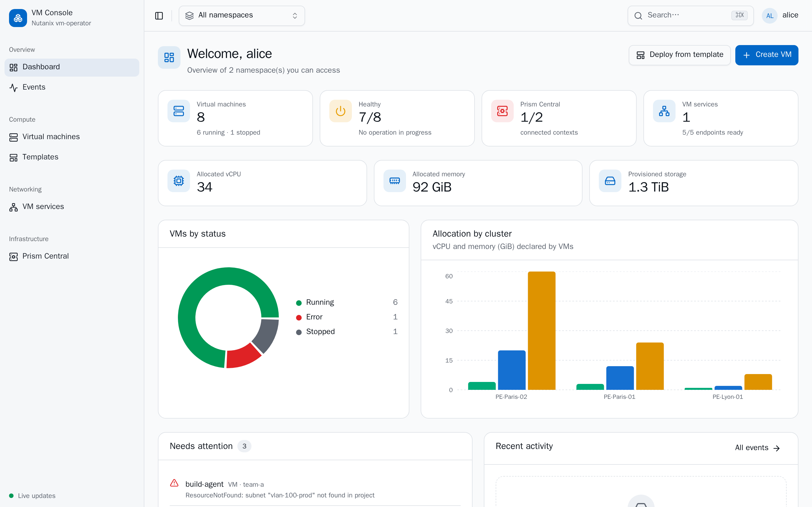
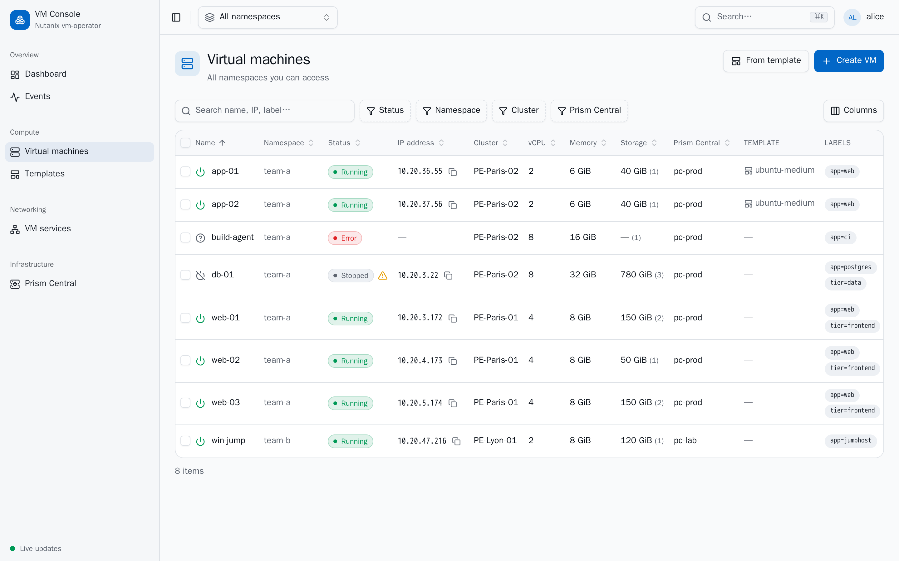
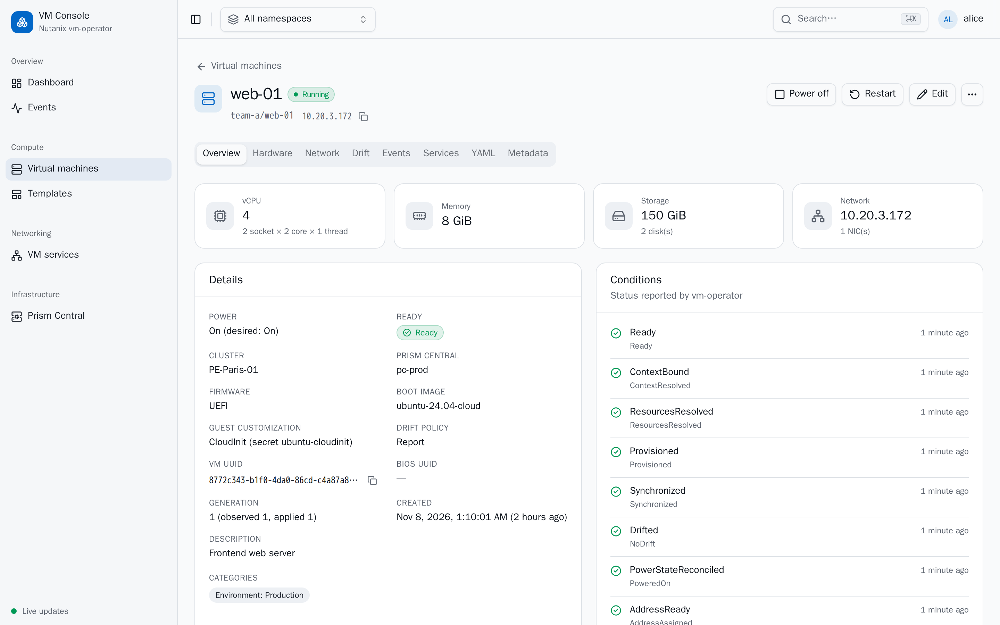
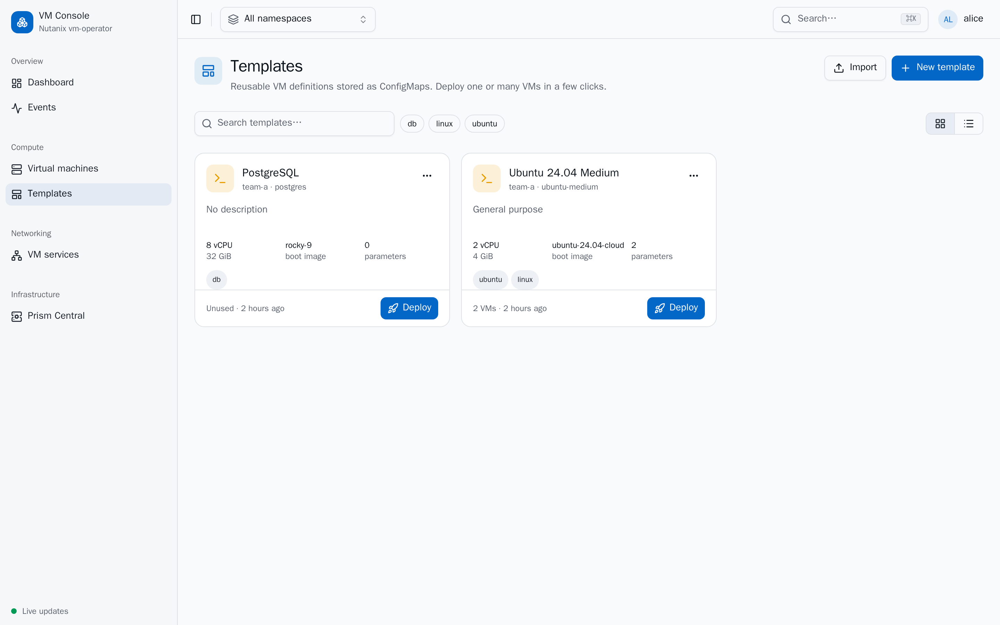
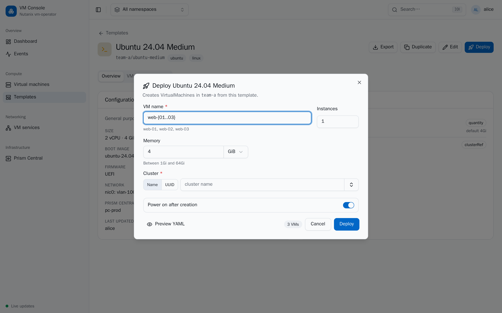
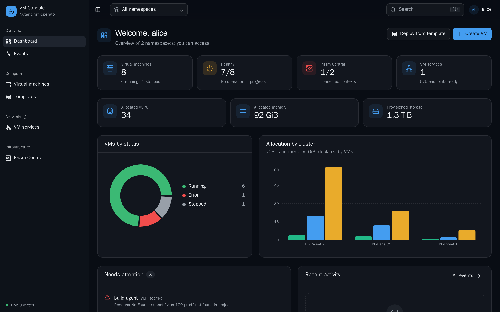

# vm-operator-console

A modern, responsive web console for the [Nutanix vm-operator](../vm-operator).
It manages the operator's Custom Resources — `VirtualMachine`,
`VirtualMachineService` and `NutanixPrismContext` — and adds reusable VM
**templates** stored as plain ConfigMaps (no extra CRD).

- **Backend**: Bun + Hono (typed RPC) + Zod, a lightweight HTTP/2 Kubernetes client
- **Frontend**: React + Vite + Tailwind v4 + shadcn/ui + TanStack Router/Query/Table
- **Packaging**: one container (Bun single-file binary serving the built SPA) + a Helm chart
- **Tooling**: every tool and task is managed by [mise](https://mise.jdx.dev)



## Screenshots

| Virtual machines | VM detail |
|---|---|
|  |  |
| **Templates** | **Deploy from a template** |
|  |  |
| **Dark theme** | |
|  | |

## Features

| Area | Capabilities |
|---|---|
| Dashboard | KPIs (VMs, health, Prism Central connectivity, services), capacity (vCPU/memory/storage), status and per-cluster charts, “needs attention” list, recent activity |
| Virtual machines | Sortable/filterable table with facets, saved column layout, search in URL, mobile card view, bulk actions (power, restart, labels, pause, delete), live updates |
| VM detail | Overview, conditions, hardware (disks/CD-ROMs with observed sizes), network (NICs, MAC, assigned vs learned addresses), drift (with “Enforce”), events timeline, exposing services, YAML, labels/annotations |
| Lifecycle | Create (form or YAML) with live validation mirroring the CRD CEL rules and the operator's admission policies, edit with diff review, power on/off, restart (off→on orchestration), pause/resume reconciliation, clone (same or another namespace), delete with type-to-confirm |
| Day-2 safety | Hot-plug vs power-off awareness (“power off as part of this change”), grow-only disks, immutable fields locked, explicit confirmation for data/boot disk deletion (sets the operator's opt-in annotations), optimistic concurrency |
| Templates | Library (grid/list, tags, search, usage count), editor with **deploy-time parameters** (“Ask” chips on any field, typed: text, integer, quantity, enum, cluster/subnet/image/storage container refs), deploy 1–N VMs with name patterns (`web-{01..05}`), save an existing VM as template, duplicate, YAML import/export, traceability labels on VMs |
| Prism Central | Accounts = context + credential Secret + CA ConfigMap created atomically, test connection, rotate credentials, edit endpoint/TLS, usage and safe delete |
| Catalog | Read-only Prism Central v4 proxy feeding pickers for clusters, subnets, images, storage containers (free entry always possible) |
| VM services | ClusterIP / headless / LoadBalancer, label selector with live preview of matching and eligible VMs, ports, TCP probing, endpoints view |
| UX | Light/dark/system theme, ⌘K command palette, responsive layout, English UI |

## Security model

```
Browser ──► Traefik (NKP) + remote-auth ──► console ──► kube-apiserver
             X-Forwarded-User / -Groups        Impersonate-User / Impersonate-Group
```

- The console runs with a ServiceAccount but performs **every user-facing
  Kubernetes call (reads, watches and writes) by impersonating the
  authenticated user**. Kubernetes RBAC and audit therefore apply to the real
  user. There is never a fallback to the ServiceAccount's own rights.
- The namespace picker and the UI permissions come from SubjectAccessReviews
  evaluated for the user (cached `PERMISSIONS_TTL_SECONDS`).
- The ServiceAccount itself only needs: `impersonate` users/groups, `create`
  (self)subjectaccessreviews, `list` namespaces, and `get` Secrets/ConfigMaps
  for the Prism catalog proxy (after checking the user can read the context).
- Identity headers are trusted only from the proxy: the chart ships a
  NetworkPolicy allowing ingress from Traefik pods only; `auth.trustedProxies`
  adds a CIDR check. CSRF protection, strict CSP and secure headers are on.
- Secret values (Prism passwords, API keys, cloud-init) are never returned to the browser.

The chart provides aggregated end-user roles to bind to your groups:
`vm-console-viewer`, `vm-console-operator`, `vm-console-admin` (templates and
Prism Central accounts need ConfigMap/Secret write access in the namespace).

## Templates format

A template is a ConfigMap labelled `console.nutanix.com/type=vm-template`,
named `vmt-<id>`:

```yaml
data:
  formatVersion: "1"
  virtualmachine.yaml: |   # a VirtualMachine manifest without name/namespace/biosUUID/status
    apiVersion: vmm.v4.nutanix.com/v1alpha1
    kind: VirtualMachine
    spec: { ... }
  parameters.yaml: |       # values asked at deploy time (JSON pointers into the manifest)
    - { name: cluster, path: /spec/placement/cluster, type: clusterRef, required: true }
    - { name: memory, path: /spec/compute/memorySize, type: quantity, min: 1Gi, max: 64Gi }
```

Templates are validated with the shared rules and a server-side dry-run of the
rendered VM, so the API server applies the real CRD schema and the operator's
ValidatingAdmissionPolicies. Deployed VMs carry `console.nutanix.com/template`
and `console.nutanix.com/source-template` for traceability.

## Repository layout

```
packages/shared   Zod schemas generated from the CRDs, validation rules (CEL/VAP), templates, VM helpers
apps/server       Hono API + K8s client (HTTP/2, impersonation, watches) + Prism proxy + SPA hosting
apps/web          React SPA
e2e               Playwright end-to-end tests
charts/           Helm chart
hack/             kind fixtures (users, RBAC, sample objects), fake operator status, fake auth proxy
scripts/          CRD → Zod generator
```

## Development

```sh
mise install                 # bun, kubectl, helm, kind
mise run kind:seed           # kind cluster + vm-operator CRDs/VAPs + test users and objects
mise run dev                 # API on :8080 (kubeconfig, impersonating alice) + Vite on :5173
mise run kind:fake-operator  # optional: simulate operator status changes
```

The dev identity is set by `DEV_USER`/`DEV_GROUPS`. Seeded users:
`alice` (group `team-a-admins`: admin of team-a, viewer of team-b), `bob`
(group `team-b-ops`: operator of team-b), `carol` (no access).

Regenerate schemas after a CRD change in vm-operator: `mise run gen:schemas`.

## Quality

```sh
mise run ci                  # lint, typecheck, unit tests, builds, chart lint, image
mise run test:e2e            # Playwright against BASE_URL (default http://127.0.0.1:8080)
mise run test:e2e:cluster    # build image → deploy chart in kind → e2e through a fake remote-auth proxy
```

Playwright runs on Bun inside the official Playwright image extended with Bun
(`hack/playwright.Dockerfile`, wrapped by `hack/playwright.sh`), so no browser
libraries are needed on the host. Regenerate the documentation screenshots with:

```sh
mise run kind:open   # in another terminal
PW_OUT=$PWD/docs/screenshots hack/playwright.sh bun screenshots.ts http://127.0.0.1:8092 /out
```

## Deployment

CI (`.github/workflows/ci.yml`) publishes to GHCR:

| Trigger | Image `ghcr.io/funkolab/vm-operator-console` | Chart `oci://ghcr.io/funkolab/charts/vm-operator-console` |
|---|---|---|
| Pull request | built (amd64 + arm64), not pushed | — |
| Push to `main` | `main`, `sha-<short>` | — |
| Tag `vX.Y.Z` | `X.Y.Z`, `X.Y`, `X` (from 1.0), `latest`, `sha-<short>` | `X.Y.Z` (chart `version` and `appVersion` set from the tag) |

```sh
git tag v0.1.0 && git push origin v0.1.0
helm upgrade --install vm-operator-console oci://ghcr.io/funkolab/charts/vm-operator-console \
  --version 0.1.0 -n vm-console --create-namespace \
  --set ingress.traefik.host=vm-console.example.com
```

Manual build and deploy to another registry:

```sh
mise run docker:push IMAGE_REPO=registry.example.com/vm-operator-console IMAGE_TAG=0.1.0
helm upgrade --install vm-operator-console charts/vm-operator-console -n vm-console --create-namespace \
  --set image.repository=registry.example.com/vm-operator-console --set image.tag=0.1.0 \
  --set ingress.traefik.host=vm-console.example.com \
  --set 'ingress.traefik.middlewares[0].name=remote-auth' \
  --set 'ingress.traefik.middlewares[0].namespace=kommander'
```

Key values: `auth.userHeader` / `auth.groupsHeader` (headers set by the
remote-auth middleware), `basePath` (when served under a prefix),
`watchNamespaces`, `rbac.bindings` (bind groups to the provided roles),
`networkPolicy.traefikNamespaceLabels` / `traefikPodLabels`. On first install,
`auth.debug=true` exposes `/api/debug/identity` to verify the received headers.

### Configuration (environment)

| Variable | Default | Description |
|---|---|---|
| `PORT` / `BASE_PATH` | `8080` / `""` | Listen port, URL prefix |
| `K8S_MODE` | `auto` | `in-cluster`, `kubeconfig` (`KUBECONFIG`, `K8S_CONTEXT`) |
| `AUTH_MODE` | `traefik` | `traefik`, `dev` (refused in-cluster), `none` |
| `AUTH_USER_HEADER` / `AUTH_GROUPS_HEADER` | `X-Forwarded-User` / `X-Forwarded-Groups` | Identity headers |
| `AUTH_TRUSTED_PROXIES` | | CIDRs allowed to send identity headers |
| `WATCH_NAMESPACES` | | Restrict candidate namespaces |
| `PRISM_PROXY_ENABLED` / `PRISM_CACHE_TTL_SECONDS` | `true` / `120` | Catalog proxy |

The configuration is validated with Zod at startup; invalid values abort with a clear message.
